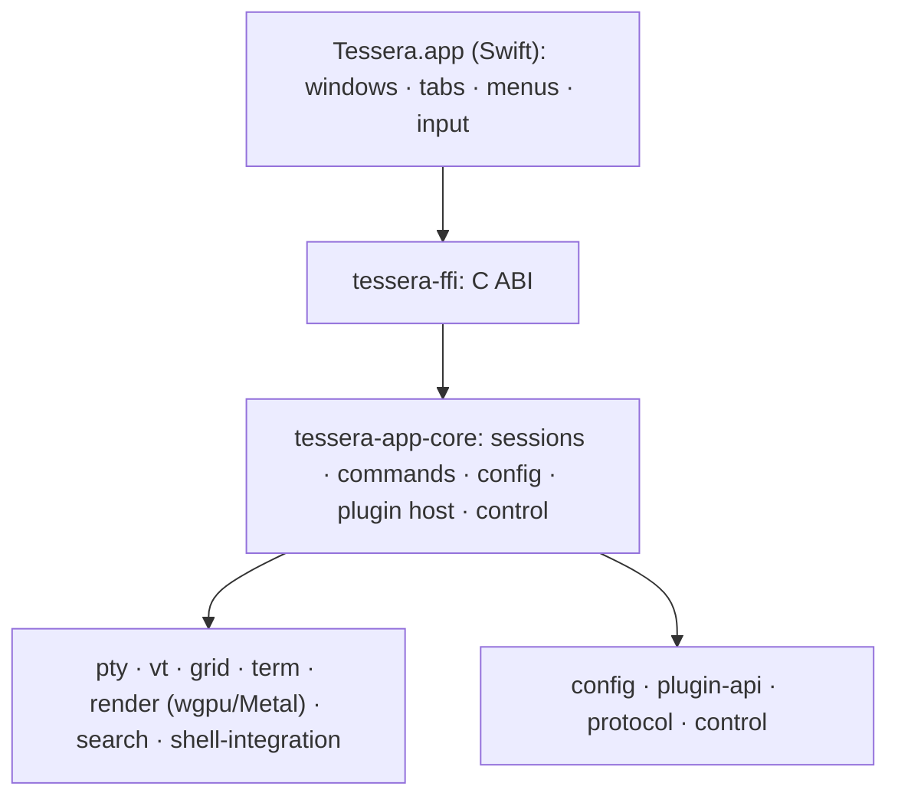

# Tessera

A native macOS terminal emulator with a polished, approachable interface, built on a fast, modular Rust core.

> **Status:** approaching 0.1.0, the first daily-drivable release. Windows, tabs, scrollback, selection, links,
> themes and `config.toml` work today. Splits, a Preferences window, search and profiles in the UI are planned for
> 0.2.0 (see [Roadmap](#roadmap)).

## Why Tessera

Tessera started from a gap. Terminals that feel at home on a Mac (native windows and tabs, a real Preferences window,
profiles, shell integration) tend to be large, older codebases that are hard to extend and slow in places. Terminals
with a fast, well-built core tend to bring their own non-native interface and expect you to configure everything in a
scripting language.

Tessera aims to offer both: the native, approachable feel on top of a small Rust core. That core is designed from the
first commit for what a terminal rarely gets: plugins that share one API with external control (a socket and a
command-line client, so scripts and agents can drive your terminals, with your consent), and frontends for other
platforms on the same core.

## Install

Requires macOS 15 or later, on Apple silicon or Intel.

1. Download `Tessera-<tag>-macos-universal.zip` from the
   [latest release](https://github.com/aanyberg/tessera/releases/latest) and unzip it.
2. Move `Tessera.app` to `/Applications` and open it.

## User guide

### Windows, tabs and shortcuts

The menu bar follows the standard macOS layout, and the shortcuts are fixed until the configurable key map
([#43](https://github.com/aanyberg/tessera/issues/43)).

<details>
<summary>Keyboard shortcuts</summary>

| Shortcut | Menu item | What it does |
|---|---|---|
| ⌘, | Tessera > Settings… | Opens the Settings window, or brings it to the front (Tessera > Open config.toml opens the file itself) |
| ⌘N | Shell > New Window | A new window with a new shell |
| ⌘T | Shell > New Tab | A new tab in the current window |
| ⌘W | Shell > Close Tab | Closes the current tab |
| ⇧⌘W | Shell > Close Window | Closes every tab of the current window |
| ⌘K | Shell > Clear to Start | Clears the scrollback and the screen above the prompt line |
| ⌘C | Edit > Copy | Copies the selected text (plain text; nothing is copied by selecting) |
| ⌘V | Edit > Paste | Pastes the clipboard's text (bracketed when the program asks) |
| ⌥⇧⌘V | Edit > Paste as Plain Text | The same as Paste for now |
| ⌘A | Edit > Select All | Selects the scrollback and the screen |
| ⌘+ or ⌘= | View > Bigger | Text 1 pt larger, in the current tab |
| ⌘- | View > Smaller | Text 1 pt smaller, in the current tab |
| ⌘0 | View > Actual Size | Back to the configured font size |
| ⌘M | Window > Minimize | Minimises the window |
| ⇧⌘[ and ⇧⌘] | Window > Show Previous/Next Tab | Moves between tabs |
| ⌘1 to ⌘9 | Window > Select Tab | Selects one of the first nine tabs |
| ⌘? | Help > Tessera Help | Opens this page |

</details>

Closing a window or tab that is running a job asks first (`confirm_close`).

### Mouse and links

- Drag to select, double-click for a word, triple-click for a line, ⇧-click to move the nearer end of the selection,
  ⌥-drag (or ⌥⌘-drag) for a block. Dragging above or below the window scrolls.
- ⌘-hover underlines a link, ⌘-click opens `http`, `https`, `mailto`, `ftp` and local `file` links (a local app,
  script or similar file is shown in Finder instead of launched).
- A program that tracks the mouse (vim, tmux, htop) gets the clicks instead; hold ⇧ to select anyway.

### Configuration

Tessera reads `~/Library/Application Support/Tessera/config.toml`. Settings (⌘,) edits the common keys in place,
keeping your comments; Tessera > Open config.toml creates the file with every default commented and opens it. Every key is optional, saved edits apply to all open windows within a few seconds, and a file
that does not parse never stops Tessera: the error is reported and the last good configuration stays in effect.

```toml
[appearance]
theme = "Dracula"
font_family = "Menlo"
font_size = 14.0
opacity = 0.95

[terminal]
scrollback_lines = 50000
```

Ten themes are bundled (Tessera Dark and Light, Solarized Dark and Light, Dracula, Nord, Gruvbox Dark, One Dark,
Tokyo Night, Catppuccin Mocha), and your own go in a `themes/` folder next to `config.toml`. Every key is documented
in the [configuration reference](docs/config.md).

### Shell integration

For zsh and fish, Tessera loads its shell integration automatically (bash support is to follow). It marks prompts
and commands and reports each shell's working directory. Set `shell_integration = "off"` under `[terminal]` to
disable it. Details in [`shell-integration/README.md`](shell-integration/README.md).

### Privacy and safety

Programs can write to your clipboard (OSC 52, up to 1 MiB per write, as tmux and Neovim do over `ssh`) but can never
read it; turn writes off with `clipboard_write = false`. Nothing a program prints is ever echoed back as input. The
rules are in [`docs/security.md`](docs/security.md).

## Roadmap

Scheduled work is tracked in [GitHub milestones](https://github.com/aanyberg/tessera/milestones).

**Where it is heading.** The core is built so a terminal can be driven and extended, not only used: a control socket
and a `tessera` command-line client, an MCP server so agents can work with your terminals (with your consent), a
usage tracker for Claude Code, Codex and Copilot, sandboxed WASM plugins, inline images, tmux integration, and a
Linux frontend on the same core. These are open issues labelled
[`backlog`](https://github.com/aanyberg/tessera/issues?q=is%3Aissue+is%3Aopen+label%3Abacklog), not scheduled
work; each is shaped when it is picked up. A 1.0.0 will be defined once the 0.x releases are stable.

### Plugins

Plugins implement one trait (`tessera-plugin-api`) and declare the capabilities they need. v1 links first-party
plugins into the binary and, from 0.2.0, toggles them from Preferences. v2 loads third-party plugins as sandboxed WASM
components using the same API.

## Contributing

### Building from source

Requirements: macOS 15+, Xcode 16+, Rust stable (via `rustup`), and
`brew install just cbindgen cargo-deny cargo-nextest xcodegen`. For the universal build also
`rustup target add aarch64-apple-darwin x86_64-apple-darwin`.

```sh
just check     # fmt, clippy -D warnings, tests, cargo-deny
just app       # universal xcframework + Xcode build
just app-test  # TesseraKit XCTest suite (headless, Thread Sanitizer)
just run       # launch Tessera.app
```

Workflow and commit conventions are in [`CONTRIBUTING.md`](CONTRIBUTING.md); testing, debugging and releasing are
under [`docs/`](docs/).

### Architecture

A thin Swift shell over a modular Rust core. Dependencies point downward only, everything below the shell is
OS-agnostic, plugins and the control socket share one host API, and everything that crosses a boundary is
`serde`-serializable. The full picture, the crate map and the data flow are in
[`docs/architecture.md`](docs/architecture.md), and the decisions behind them in [`docs/adr/`](docs/adr/).

<details>
<summary>Layers at a glance</summary>



</details>

### Development with agents

Milestone work runs as an agent team over a fixed roster of project agents in `.claude/agents/`; see
[`docs/software-factory.md`](docs/software-factory.md).

## License

MIT OR Apache-2.0, at your option.
